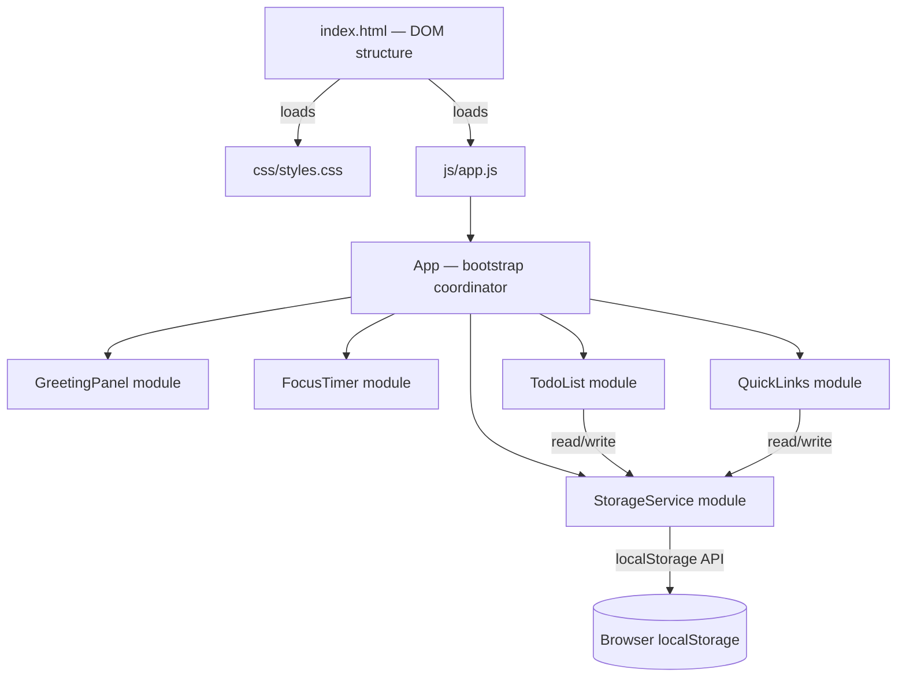
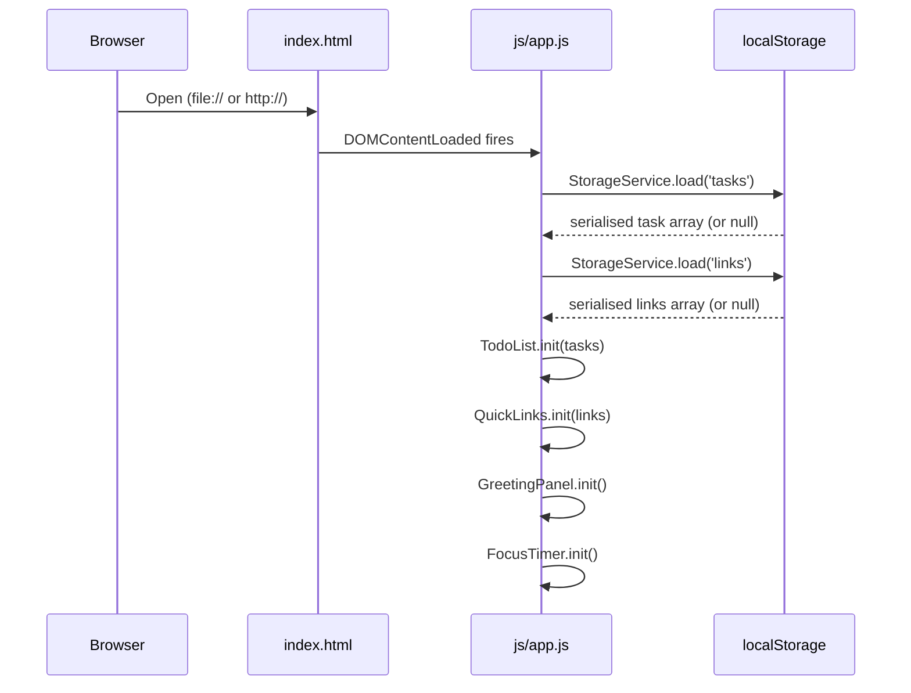

# Design Document

## Overview

The Todo Life Dashboard is a self-contained, single-page personal productivity application built with pure HTML5, CSS3, and Vanilla JavaScript. It runs entirely in the browser without a backend or any external dependencies, making it portable as both a standalone `file://`-opened web page and a potential browser extension.

The application is composed of four independent feature panels rendered on a single HTML page:

1. **Greeting_Panel** — Live clock, full date, and a time-contextual greeting.
2. **Focus_Timer** — A Pomodoro-style 25-minute countdown with Start, Stop, and Reset controls.
3. **Todo_List** — A full CRUD task manager with inline editing, completion toggling, and Local Storage persistence.
4. **Quick_Links** — A user-curated shortcut panel with add and delete controls, persisted to Local Storage.

All data persistence uses the browser's `localStorage` API. No server, no build tools, no frameworks — the deliverable is three files: `index.html`, `css/styles.css`, and `js/app.js`.

---

## Architecture

### High-Level Architecture

The application follows a **Module Pattern** within a single JavaScript file. Each feature panel is encapsulated in its own module object, which owns its DOM references, state, and methods. A thin `App` coordinator bootstraps all modules on `DOMContentLoaded` and wires up any cross-module interactions (e.g. Local Storage error banner).



### Execution Flow



### Design Principles

- **No framework dependency** — All DOM manipulation uses the native `document` API.
- **Module encapsulation** — Each panel is an IIFE-based module; state is not shared globally.
- **Single source of truth** — Each module holds its data in an in-memory array; every mutation writes the whole array to `localStorage` before returning.
- **Graceful degradation** — If `localStorage` is unavailable, a persistent warning banner is shown and the app continues in a stateless mode.

---

## Components and Interfaces

### 1. `App` (Bootstrap Coordinator)

Responsibility: initialise all modules in the correct order and handle the `localStorage` unavailability banner.

```
App.init()
  → StorageService.isAvailable() → bool
  → GreetingPanel.init()
  → FocusTimer.init()
  → TodoList.init()
  → QuickLinks.init()
  → if !available: showStorageBanner()
```

---

### 2. `StorageService` Module

Responsibility: wrap all `localStorage` reads and writes; surface errors to the caller.

```
StorageService = {
  isAvailable()  → boolean
  load(key)      → any | null          // JSON.parse; returns null on missing or parse error
  save(key, val) → { ok: true } | { ok: false, error: Error }
}
```

**Keys used:**
| Key | Type stored |
|---|---|
| `tld_tasks` | `Task[]` |
| `tld_links` | `Link[]` |

---

### 3. `GreetingPanel` Module

Responsibility: display live time, formatted date, and time-based greeting. Refresh every second via `setInterval`.

```
GreetingPanel = {
  init()          → void   // queries DOM refs, starts interval
  _render(now)    → void   // updates #greeting-time, #greeting-date, #greeting-msg
  _formatDate(d)  → string // "Monday, 26 November 2025"
  _formatTime(d)  → string // "HH:MM:SS"
  _getGreeting(h) → string // returns greeting string for hour 0-23
}
```

**Greeting logic:**

| Hour range | Message |
|---|---|
| 05 – 11 | "Good Morning" |
| 12 – 17 | "Good Afternoon" |
| 18 – 21 | "Good Evening" |
| 22 – 04 | "Good Night" |

---

### 4. `FocusTimer` Module

Responsibility: maintain a 25-minute countdown; manage Start / Stop / Reset controls and session-end notification.

```
FocusTimer = {
  init()    → void
  _start()  → void   // begins setInterval(1000), disables Start btn
  _stop()   → void   // clears interval, enables Start btn if remaining > 0
  _reset()  → void   // clears interval, restores to 1500s, enables Start btn
  _tick()   → void   // decrements remainingSeconds; if 0 → _onEnd()
  _onEnd()  → void   // stops timer, shows session-end message
  _render() → void   // updates #timer-display in MM:SS
}
```

State:
```
{
  remainingSeconds: number,  // 0–1500
  intervalId: number | null,
  running: boolean
}
```

---

### 5. `TodoList` Module

Responsibility: full CRUD for tasks, inline editing, completion toggling, Local Storage sync.

```
TodoList = {
  init()                    → void
  _addTask(text)            → void   // creates Task, pushes to tasks[], persists, renders
  _deleteTask(id)           → void   // removes from tasks[], persists, re-renders
  _toggleComplete(id)       → void   // flips task.done, persists, re-renders
  _beginEdit(id)            → void   // swaps text to editable <input>
  _confirmEdit(id, text)    → void   // updates task.text, persists, re-renders
  _cancelEdit(id)           → void   // discards edit, re-renders
  _validateInput(text)      → boolean  // rejects empty / whitespace-only
  _persist()                → void   // calls StorageService.save('tld_tasks', tasks)
  _renderList()             → void   // full re-render of #todo-list
  _renderItem(task)         → HTMLElement
}
```

---

### 6. `QuickLinks` Module

Responsibility: add, display, and delete quick-access link buttons; validate URL and duplicate constraints.

```
QuickLinks = {
  init()              → void
  _addLink(label, url) → void   // validates, creates Link, persists, renders
  _deleteLink(id)     → void   // removes from links[], persists, re-renders
  _validateLink(label, url, existingLinks) → ValidationResult
  _persist()          → void
  _renderLinks()      → void   // full re-render of #links-grid
  _renderButton(link) → HTMLElement
}

ValidationResult = { valid: boolean, field?: 'label'|'url', message?: string }
```

**Validation rules (in evaluation order):**
1. Label empty → reject.
2. URL empty → reject.
3. URL does not start with `http://` or `https://` → reject.
4. URL already saved → reject.
5. Count of saved links ≥ 20 → reject.

---

## Data Models

### `Task`

```js
{
  id:        string,   // crypto.randomUUID() or Date.now().toString() fallback
  text:      string,   // 1–200 chars, trimmed
  done:      boolean,  // false = incomplete, true = complete
  createdAt: number    // Unix timestamp ms (Date.now())
}
```

### `Link`

```js
{
  id:    string,   // crypto.randomUUID() or Date.now().toString() fallback
  label: string,   // 1–50 chars, trimmed
  url:   string    // 1–2048 chars; must start with http:// or https://
}
```

### Local Storage Payloads

Both keys store a JSON-serialised array:

```
tld_tasks → Task[]   (e.g. [{"id":"...","text":"Buy milk","done":false,"createdAt":1700000000000}])
tld_links → Link[]   (e.g. [{"id":"...","label":"GitHub","url":"https://github.com"}])
```

On load, `JSON.parse` failure or missing key results in an empty array being used (see Requirement 3.11, 4.11).

---

## Correctness Properties

*A property is a characteristic or behavior that should hold true across all valid executions of a system — essentially, a formal statement about what the system should do. Properties serve as the bridge between human-readable specifications and machine-verifiable correctness guarantees.*

### Property 1: Date formatting always produces the full structured string

*For any* valid JavaScript `Date` object, `GreetingPanel._formatDate(d)` SHALL return a non-empty string that contains the full English weekday name, the numeric day-of-month, the full English month name, and the four-digit full year, in that order.

**Validates: Requirements 1.1**

---

### Property 2: Time formatting always produces zero-padded HH:MM:SS

*For any* valid JavaScript `Date` object, `GreetingPanel._formatTime(d)` SHALL return a string matching the pattern `\d{2}:\d{2}:\d{2}` where hours are in the range 00–23, minutes 00–59, and seconds 00–59.

**Validates: Requirements 1.2**

---

### Property 3: Greeting is correct for every possible hour

*For any* integer hour `h` in `[0, 23]`, `GreetingPanel._getGreeting(h)` SHALL return exactly:
- `"Good Morning"` when `h ∈ [5, 11]`
- `"Good Afternoon"` when `h ∈ [12, 17]`
- `"Good Evening"` when `h ∈ [18, 21]`
- `"Good Night"` when `h ∈ [22, 23] ∪ [0, 4]`

No other return value is valid.

**Validates: Requirements 1.3, 1.4, 1.5, 1.6**

---

### Property 4: Timer display always produces valid MM:SS

*For any* integer `remainingSeconds` in `[0, 1500]`, `FocusTimer._render()` SHALL update the timer display element to show a string matching `\d{2}:\d{2}` where the minutes value equals `Math.floor(remainingSeconds / 60)` and the seconds value equals `remainingSeconds % 60`, both zero-padded to two digits.

**Validates: Requirements 2.7**

---

### Property 5: Stop preserves remaining time

*For any* timer state where the timer is running with `remainingSeconds > 0`, calling `FocusTimer._stop()` SHALL set `running` to `false` without changing `remainingSeconds`.

**Validates: Requirements 2.4**

---

### Property 6: Start button disabled state mirrors running state

*For any* timer state `(running, remainingSeconds)`, after `_render()` is called, the Start button's `disabled` attribute SHALL equal `running`. When `running` is `false` and `remainingSeconds > 0`, the Start button SHALL be enabled.

**Validates: Requirements 2.8**

---

### Property 7: Whitespace-only input is always invalid

*For any* string `s` composed entirely of whitespace characters (space `U+0020`, tab `U+0009`, newline `U+000A`, carriage return `U+000D`, or any Unicode whitespace), including the empty string, `TodoList._validateInput(s)` SHALL return `false`.

**Validates: Requirements 3.3, 3.7**

---

### Property 8: New tasks are always added with an incomplete state

*For any* valid task text `t` (non-empty, non-whitespace-only, length ≤ 200), calling `TodoList._addTask(t)` SHALL add exactly one new entry to `tasks[]` with `done = false` and `text = t.trim()`.

**Validates: Requirements 3.2**

---

### Property 9: Completion toggle is an involution

*For any* task in `tasks[]`, calling `TodoList._toggleComplete(id)` twice in succession SHALL leave `task.done` equal to its original value. After the first toggle, `task.done` SHALL be the logical negation of the original value.

**Validates: Requirements 3.4**

---

### Property 10: Cancelling an edit is a round trip

*For any* task with text `t`, calling `TodoList._beginEdit(id)` followed by `TodoList._cancelEdit(id)` SHALL leave `task.text` equal to `t` — unchanged from before the edit began.

**Validates: Requirements 3.5**

---

### Property 11: Task and Link persistence round-trip

*For any* array of tasks (or links), calling `_persist()` followed by `StorageService.load('tld_tasks')` (or `'tld_links'`) SHALL return an array whose items are structurally equivalent to the original array — same count, same `id`, `text`/`label`/`url`, and `done` values.

**Validates: Requirements 3.9, 4.9, 4.10, 5.2**

---

### Property 12: URL validation rejects non-http(s) schemes

*For any* non-empty string `url` that does not begin with the literal prefix `"http://"` or `"https://"`, `QuickLinks._validateLink(label, url, existingLinks)` SHALL return `{ valid: false, field: 'url' }` regardless of the value of `label` or `existingLinks`.

**Validates: Requirements 4.4**

---

### Property 13: Duplicate URL is always rejected

*For any* non-empty `links[]` array containing a link with URL `u`, calling `QuickLinks._validateLink(label, u, links)` SHALL return `{ valid: false }` — even if `label` is different from the existing entry's label.

**Validates: Requirements 4.5**

---

## Error Handling

### Local Storage Unavailability

`StorageService.isAvailable()` wraps a test write/read/delete in a try-catch. If it throws (e.g. private browsing quota exceeded, security restriction under `file://` in some browsers), the flag is set to `false` for the session.

When `App.init()` detects `isAvailable() === false`, it inserts a persistent `<div id="storage-banner">` at the top of the page before any module initialises, containing the message: *"Warning: Local Storage is unavailable. Your tasks and links will not be saved."*

All `StorageService.save()` calls return `{ ok: false, error }` silently — modules continue operating in-memory without crashing.

### Invalid Date from System Clock

`GreetingPanel._render(now)` checks `isNaN(now.getTime())`. If true, it hides the time and date elements and sets the greeting text to `"Welcome!"`. The `setInterval` continues running so that if the clock recovers, the display self-corrects.

### Task / Link Validation

Validation errors are displayed as inline `<span class="field-error">` elements injected adjacent to the relevant input. The error is cleared on the next `input` event on that field. No modal dialogs are used.

### Edit Cancellation

Pressing `Escape` during an active edit fires `_cancelEdit(id)`, which replaces the inline `<input>` with the original text node without touching `tasks[]` or Local Storage.

---

## Testing Strategy

### Unit Tests

Unit tests cover specific examples, edge cases, and boundary conditions. Written without a test framework (plain assertions using `console.assert`) since the project has no build tooling, or optionally using [QUnit](https://qunitjs.com/) in a separate `test/` directory that is excluded from the production bundle.

Covered scenarios:
- `_formatDate` with specific known dates (e.g. epoch, leap day, year rollover)
- `_getGreeting` at each boundary hour (0, 4, 5, 11, 12, 17, 18, 21, 22, 23)
- Timer initialises to 1500 seconds
- `_tick()` at `remainingSeconds = 1` transitions to stopped + session-end message
- Calling `_stop()` when already stopped is a no-op
- `_validateLink` with empty label, empty URL, non-http URL, duplicate URL, 20-link limit
- `StorageService.load()` returns `null` for missing key and `null` for malformed JSON
- `TodoList.init()` with `null` storage produces empty list with no exception

### Property-Based Tests

The project targets Vanilla JavaScript with no build system, so property-based tests use **[fast-check](https://fast-check.dev/)** loaded from a local copy in `test/lib/fast-check.min.js` (not a CDN). Tests run in a separate `test/index.html` page.

Each property-based test is configured for a minimum of 100 iterations (`{ numRuns: 100 }`).

Tag format for each test: `// Feature: todo-life-dashboard, Property {N}: {property_text}`

**Properties covered:**

| Property | Test inputs | Minimum iterations |
|---|---|---|
| P1: Date formatting | `fc.date()` | 100 |
| P2: Time formatting | `fc.date()` | 100 |
| P3: Greeting correctness | `fc.integer({ min: 0, max: 23 })` | 100 |
| P4: MM:SS display format | `fc.integer({ min: 0, max: 1500 })` | 100 |
| P5: Stop preserves time | `fc.integer({ min: 1, max: 1500 })` | 100 |
| P6: Start button mirrors state | `fc.record({ running: fc.boolean(), remaining: fc.integer({min:0,max:1500}) })` | 100 |
| P7: Whitespace input invalid | `fc.stringOf(fc.constantFrom(' ','\t','\n','\r'))` | 100 |
| P8: New tasks start incomplete | `fc.string({ minLength: 1, maxLength: 200 }).filter(s => s.trim().length > 0)` | 100 |
| P9: Toggle is involution | `fc.record({ id: fc.uuid(), text: fc.string(), done: fc.boolean() })` | 100 |
| P10: Cancel edit round-trip | `fc.record({ id: fc.uuid(), text: fc.string({ minLength: 1 }) })` | 100 |
| P11: Persistence round-trip | `fc.array(fc.record({ id: fc.uuid(), text: fc.string({min:1}), done: fc.boolean() }))` | 100 |
| P12: URL scheme validation | `fc.string().filter(s => !s.startsWith('http://') && !s.startsWith('https://'))` | 100 |
| P13: Duplicate URL rejected | `fc.array(validLinkArb, {minLength:1})` + `fc.nat(arr.length - 1)` | 100 |

### Integration / Manual Tests

The following are verified by manual cross-browser QA (Chrome, Firefox, Edge, Safari — stable release):

- All four panels render correctly on `file://` protocol with no console errors
- Responsive reflow at 768 px viewport width boundary
- WCAG 2.1 AA colour contrast verified with browser devtools and axe-core extension
- Local Storage data survives page reload (tasks and links restored)
- Local Storage warning banner appears in private/incognito mode where storage is blocked
